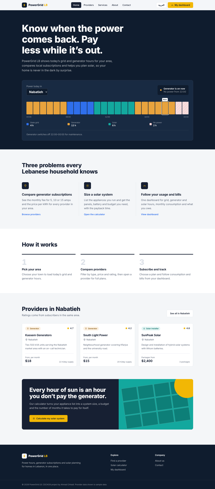
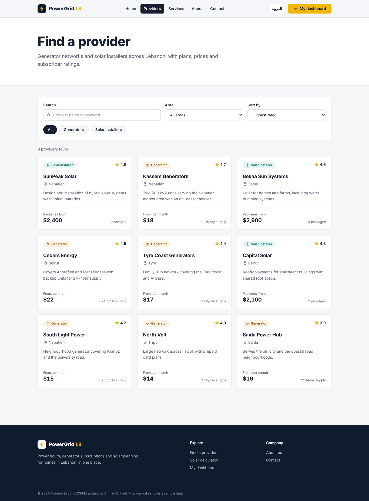
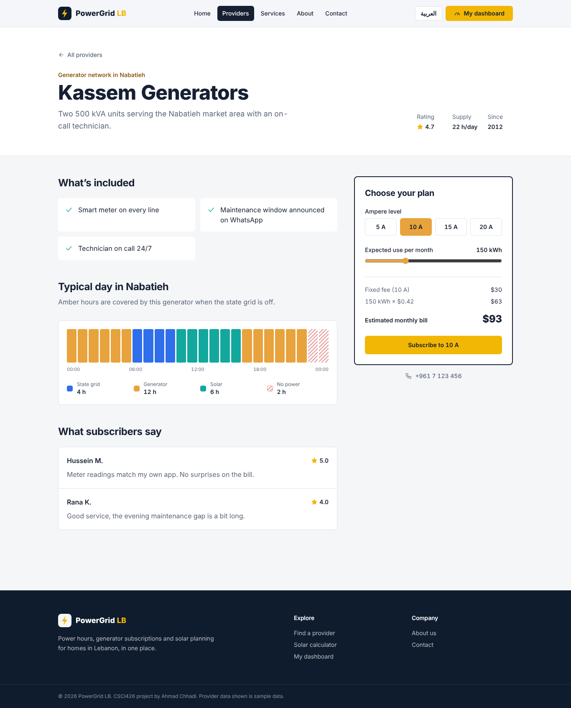
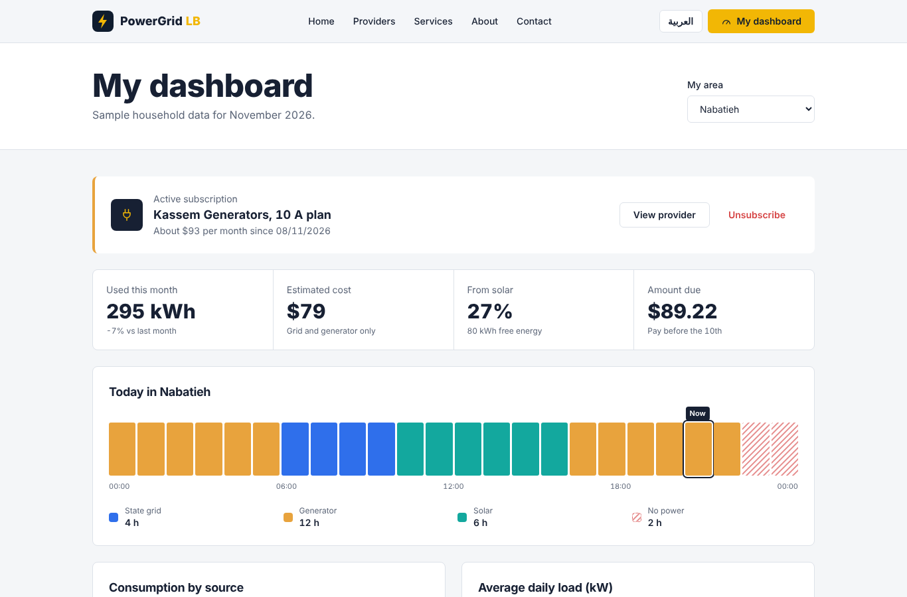
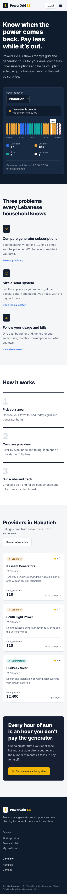
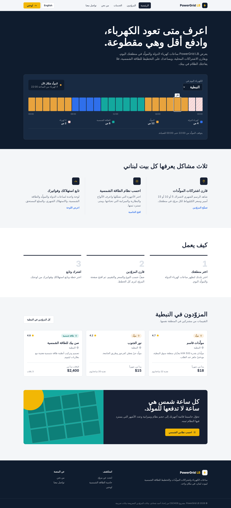
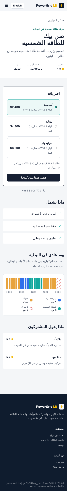

# PowerGrid LB

**Electricity and solar management platform for homes in Lebanon.**
CSCI426 Advanced Web Programming, Project Phase 1 (Fall 2026), Ahmad Chhadi.

Most Lebanese households pay for three power sources: a few hours of state grid (EDL), a neighbourhood
generator subscription for the rest of the day, and increasingly solar panels. PowerGrid LB brings them
together: it shows today's supply hours for each area, compares generator plans and solar installers,
estimates the solar system a home needs, and tracks consumption and bills in a dashboard.

**Live site:** https://powergrid-lb.vercel.app  
**Repository:** https://github.com/ahmad-chhadi/powergrid-lb

> Phase 1 is front end only. Providers, schedules and bills are sample data stored in JavaScript files.



## Features

- **Live supply strip:** a 24-hour view of grid, generator, solar and outage hours for the selected area, with the current hour and the next change.
- **Provider search:** search, filter by area and type, and sort by rating, price or hours. Filters are kept in the URL (`/providers?area=nabatieh&type=solar`).
- **Dynamic provider page (`/providers/:id`):** plans, coverage, reviews and an interactive bill estimator. Subscribing saves the plan to the dashboard.
- **Solar calculator:** choose appliances and hours of use to get system size, panel count, battery, cost and payback time.
- **Dashboard:** subscription status, key numbers, consumption by source (stacked bar chart), daily load curve and bill history. Charts are hand-written SVG.
- **Contact form** with client-side validation and a success state.
- **Arabic and English:** one button switches the whole site, with a right-to-left layout for Arabic. All interface text lives in `src/i18n/en.js` and `src/i18n/ar.js`.
- Responsive from 360 px phones to desktop, keyboard focus styles and reduced-motion support.

## Pages

| Route | Page |
|---|---|
| `/` | Home |
| `/about` | About the project |
| `/services` | Services, solar calculator and ampere guide |
| `/providers` | Provider list with search and filters |
| `/providers/:id` | Provider details (dynamic) |
| `/dashboard` | User dashboard |
| `/contact` | Contact form |
| `*` | 404 page |

## Tech stack

- [React 19](https://react.dev) with [Vite](https://vite.dev)
- [React Router](https://reactrouter.com) for navigation and URL parameters
- [Tailwind CSS v4](https://tailwindcss.com) for styling
- React Context and `localStorage` for shared state (selected area, subscription and language)
- Deployed on [Vercel](https://vercel.com)

## Run it locally

Requirements: Node.js 20.19 or newer.

```bash
git clone https://github.com/ahmad-chhadi/powergrid-lb.git
cd powergrid-lb
npm install
npm run dev
```

Open http://localhost:5173. To build for production run `npm run build`.

## Project structure

```
src/
  components/   Reusable UI: Navbar, Footer, SupplyStrip, ProviderCard, Charts, SolarCalculator
  context/      PowerContext: selected area and subscription shared across pages
  data/         Sample data: areas and schedules, providers, household usage
  i18n/         Language support: translations (en.js, ar.js), Arabic data, useData hook
  pages/        One file per route
  utils/        Schedule and money helpers, page title hook
```

## Screenshots

| Providers | Provider details |
|---|---|
|  |  |

| Dashboard | Mobile |
|---|---|
|  |  |

| Arabic (RTL) | Arabic on mobile |
|---|---|
|  |  |

## Credits

The design, icons and charts were made for this project; no UI template was used.
Fonts: [Archivo](https://fonts.google.com/specimen/Archivo) and [IBM Plex Sans Arabic](https://fonts.google.com/specimen/IBM+Plex+Sans+Arabic) from Google Fonts.
